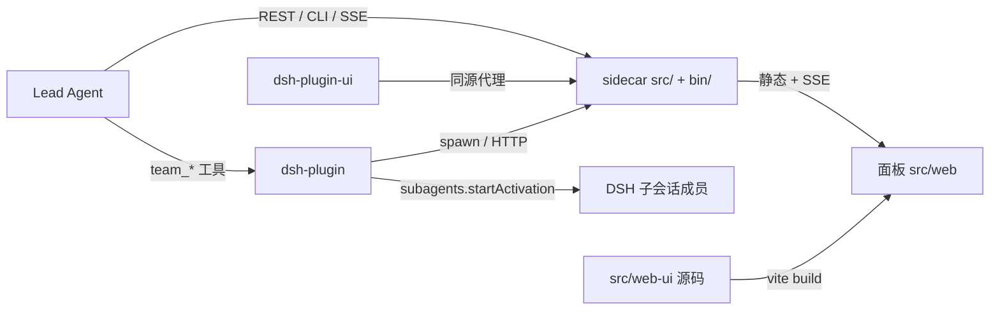

# dsh-team-control · 仓库根索引

## 项目简单介绍

dsh-team-control 给 DeepSeek Harness（DSH）的 Agent Team 加一层**独立编排 sidecar + 两个 DSH 插件**。它解决的是「多个 AI 成员并行干活时，谁在跑、谁卡在权限、谁该接着说」：成员上限可配、按 DAG 依赖自动派发、成员权限由 DSH 权限预设分配、审批经 Lead 决定、状态可回放（`event` 只增，`member_state` 是物化视图）、SSE 实时面板。

工程形态是**零依赖、零构建**的 Node ESM 后端（`engines.node >= 22.15`，实测 v24.22；依赖 `node:sqlite` 与 `module.registerHooks`），加一个 React 19 + Tailwind v4 + Vite 的面板前端（源码 `src/web-ui/`，构建产物落到 `src/web/` 由 sidecar 托管）。验收脚本全部是真实子进程 + 真实 HTTP/SSE，不 mock sidecar。

成员一律是**真 DSH sub-agent session**，由 Host 插件用 `subagents.startActivation` 拉起；sidecar 负责任务/DAG/审批镜像/看板/审计，不做进程与 IO 管理。成员的沙箱由 DSH 权限预设按成员分配，成员审批经 `team_approve` 转发给 Lead。

## 约定的规则

- **唯一口径是 [`docs/CONTRACT.md`](docs/CONTRACT.md)**（v2：成员权限改由 DSH 预设、审批经 Lead）。实现与它不符就是 bug；任何偏离必须在 [`docs/adr/`](docs/adr/) 补一份 ADR。
- 后端（`src/`、`bin/`、`dsh-plugin/`、`dsh-plugin-ui/`）保持**零第三方依赖、零构建**。新增依赖会冲击宿主 profile 的解析，先确认再动手。
- **不要手改 `src/web/assets/`**：只提交被 `src/web/panel.html` 引用的 `app-BVKjXB0l.js` 与 `panel-CQ5LqjLJ.css`（`.gitignore` 白名单）。改面板一律改 `src/web-ui/src/**` 再 `npm run build`。
- 统一 LF（`.gitattributes` 的 `* text=auto eol=lf`）。`bin/*.mjs` 带 CRLF 会让 `npm pack` 直接失败。
- 改完跑 `npm test`（全量）；单跑用 `node tests/run-all.mjs --only ac-17`。测试会自己起 sidecar、用完清理临时目录。
- 敏感值脱敏是**全局不变量**：event / audit / message / SSE / 日志 / 报告里只允许出现 `<redacted>`。
- sidecar 只监听 `127.0.0.1`；`/api/**` 与 `/panel` **免 token**（鉴权已按需求移除），因此不要把端口直接暴露到公网。
- 输出用简体中文；不主动执行 `git commit` / `reset` / `checkout`，只写代码与文档。

## 文件索引

| 文件 | 用途 | 何时阅读 |
|---|---|---|
| [架构总览](claude/overview.md) | 三进程形态、数据流、关键设计取舍 | 第一次进仓、要改架构 |
| [开发约定](claude/conventions.md) | 命令、风格、禁止事项、兼容性提醒 | 动手前后各看一次 |
| [模块职责](claude/module-responsibilities.md) | 各模块边界与所有权 | 判断改动该落在哪个目录 |
| [入口与启动](claude/entrypoints.md) | CLI / sidecar / 插件 / 面板的启动链路 | 排查「起不来」「没端口」 |
| [对外接口](claude/public-interfaces.md) | REST、SSE、CLI、14 个 `team_*` + 2 个 `board_*` 工具 | 加接口或改契约 |
| [依赖与配置](claude/dependencies-and-config.md) | Node 版本、环境变量、插件 config 字段 | 换机器、改端口/数据目录 |
| [数据模型](claude/data-model.md) | SQLite schema v9、枚举、事件溯源 | 改表、改状态机 |
| [测试与质量](claude/testing-and-quality.md) | AC 脚本矩阵（AC-01~17）、harness、演示 | 加测试或复现 bug |
| [文件地图](claude/file-map.md) | 目录与关键文件清单 | 找文件 |
| [FAQ](claude/faq.md) | 常见症状 → 定位路径 | 遇到怪现象先查这里 |
| [变更记录](claude/changelog.md) | 本套索引的生成/更新记录 | 判断索引是否过期 |

## 模块索引

| 模块 | 路径 | 职责摘要 | 文档 |
|---|---|---|---|
| 编排内核 | `src/` | 组合根、SQLite、事件流、审批镜像、调度器、信箱、SSE、HTTP 服务 | [src/CLAUDE.md](src/CLAUDE.md) |
| CLI | `bin/dsh-team.mjs` | `up/down/status/dag/logs/approvals/report`，通过 `run/sidecar.json` 发现端口 | 见 [入口与启动](claude/entrypoints.md) |
| Host 插件 | `dsh-plugin/` | 14 个 `team_*` 工具（含 `team_approve`）+ 2 个 `board_*` 工具、sidecar 生命周期、成员派发与权限预设下发、审批转发、trace/改动/产物上报 | [dsh-plugin/CLAUDE.md](dsh-plugin/CLAUDE.md) |
| GUI 面板插件 | `dsh-plugin-ui/` | 把面板挂成 better-sidebar 页签/侧栏入口，同源代理到 sidecar | [dsh-plugin-ui/CLAUDE.md](dsh-plugin-ui/CLAUDE.md) |
| 面板前端 | `src/web-ui/` | React + coss ui 面板源码，构建到 `src/web/` | [src/web-ui/CLAUDE.md](src/web-ui/CLAUDE.md) |
| 验收脚本 | `tests/` | AC-01~AC-17 + 插件/面板/路由/CLI/迁移脚本，真 sidecar + 假 ctx | [tests/CLAUDE.md](tests/CLAUDE.md) |
| 契约与决策 | `docs/` | `CONTRACT.md` 实现契约、`adr/` 11 份决策、`handoffs/` 交接 | 见 [架构总览](claude/overview.md) |
| 需求 | `prd/` | `agent-team-plugin-prd.md`（v1.0）、`implementation-brief.md` | 追溯需求来源 |
| 技能 | `skills/dsh-agent-team/` | 给模型看的调用配方，插件启动时注册为 skills provider | 改工具描述时同步 |
| 演示 | `demo/` | `run-demo.mjs` 3 个 sub-agent 成员 + DAG + 中断恢复 + 审批转发；`seed.mjs` 灌数据 | 手工验收体验 |

## 扫描状态

- 更新时间：2026-11-01
- 已扫描范围：根目录全部 `*.md`/配置；`src/*.mjs`（9 个）；`bin/dsh-team.mjs`；`dsh-plugin/`（`index.js` 2126 行通读结构 + `changes.js`/`pricing.js` 导出面）；`dsh-plugin-ui/`（`index.js`/`client.js` 结构）；`src/web-ui/src`（`App.tsx`、`store.tsx`、`shell.tsx`、`types.ts`、`lib/api.ts`、`views/`、`components/`、配置）；`tests/`（`run-all.mjs`、`lib/harness.mjs` 全导出、各脚本命名与覆盖）；`docs/CONTRACT.md` 全文；`docs/adr/` 11 份标题与状态；`prd/`、`skills/`、`demo/` 摘要。
- 跳过范围：`src/web-ui/node_modules/`（依赖）、`src/web/assets` 构建产物内容、`screenshots/*.png`、`work/essay-team/`（演示产物）、`docs/handoffs/` 正文（仅读标题）。
- 覆盖度量：仓库非忽略文件 231 个；`src/**` 与 `dsh-plugin/**` 源码全部纳入；文档覆盖 6 个模块根 + 根目录。
- 下一步建议：`src/web-ui/src/views/Home.tsx` 与 `store.tsx`（约 1000 行）只看结构未逐行读；`dsh-plugin/index.js` 的 `buildTools` 内 16 个工具 execute 细节按需补扫；`docs/handoffs/` 三份交接正文如需复现历史事故再展开。
