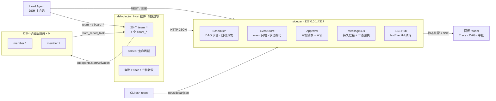
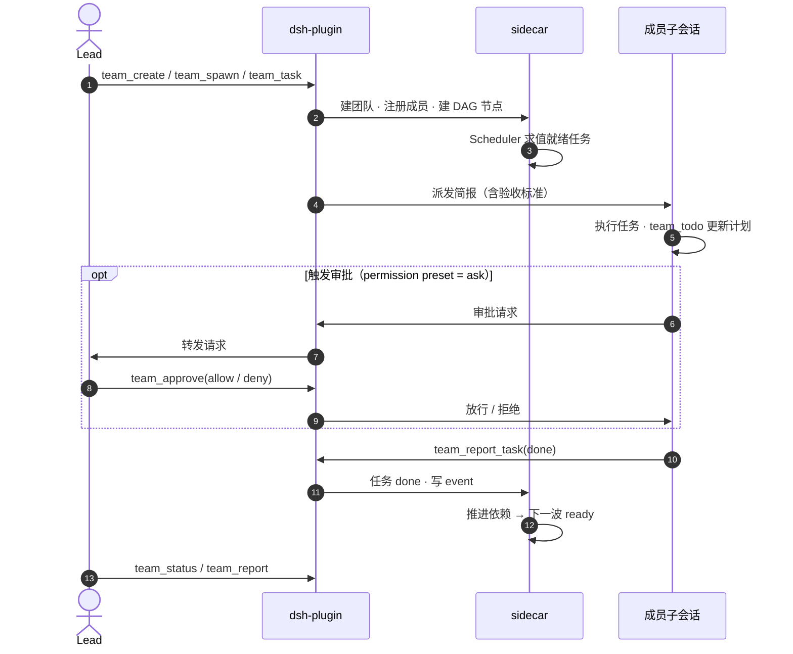
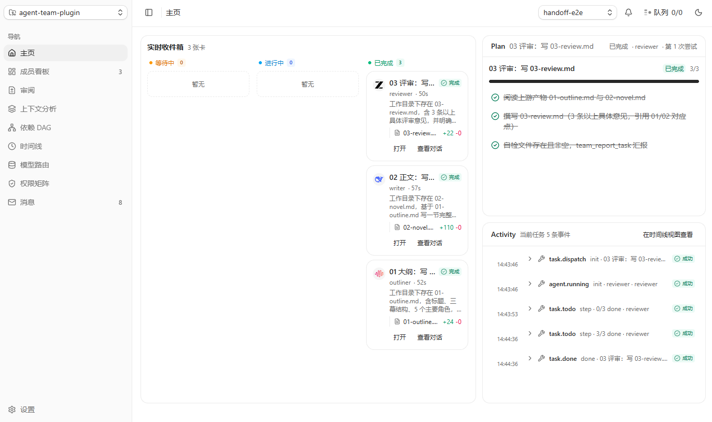
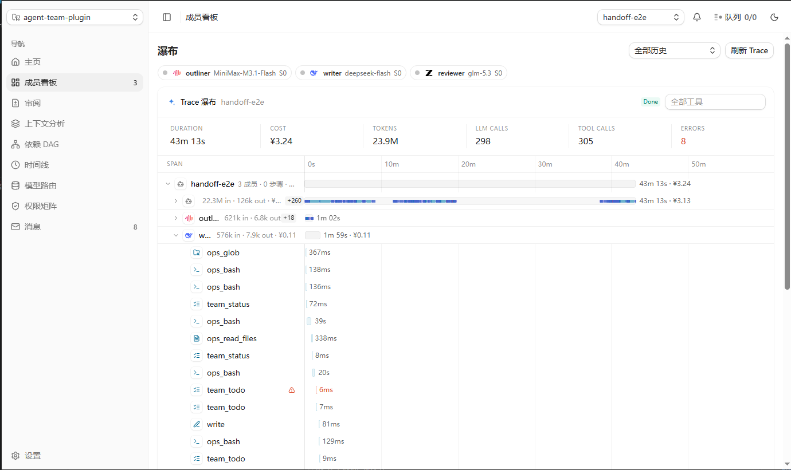
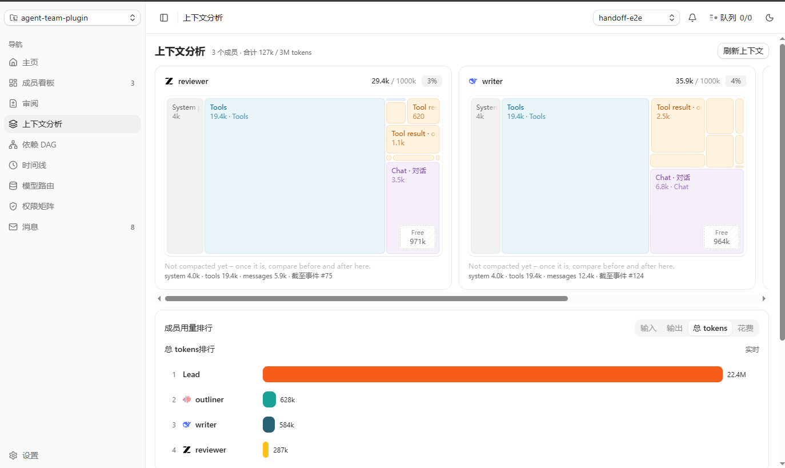
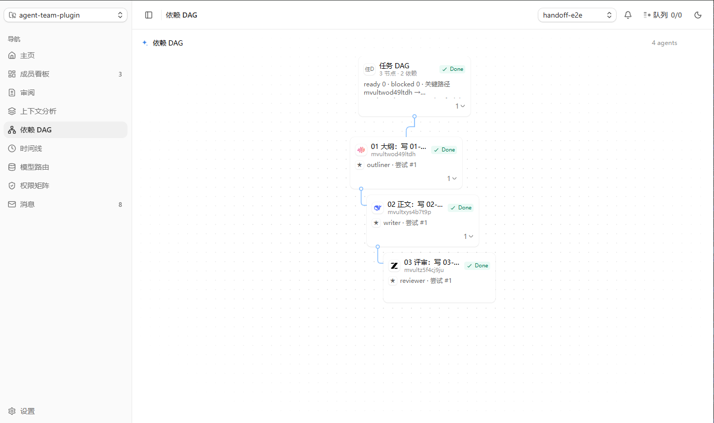
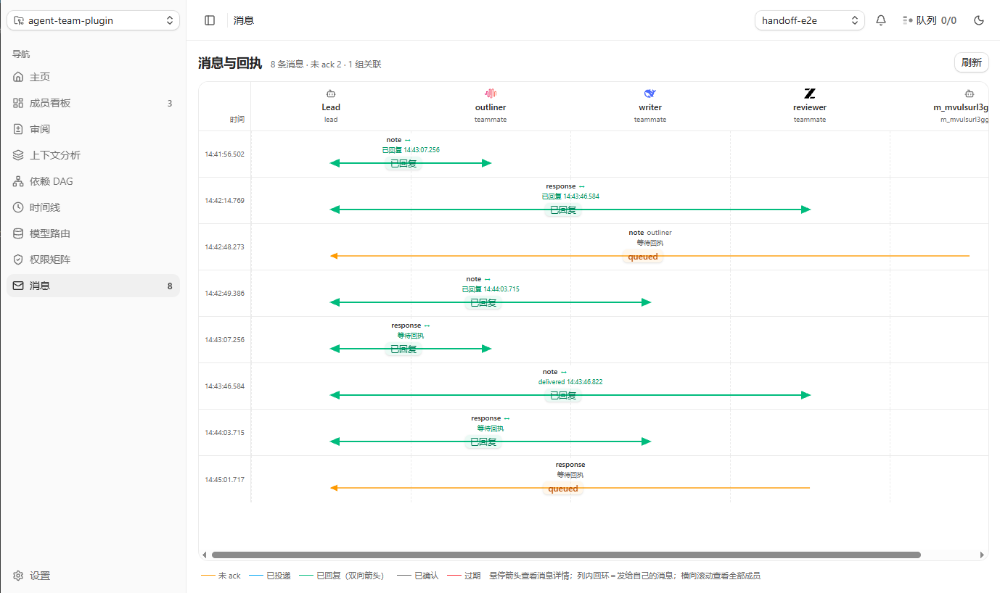
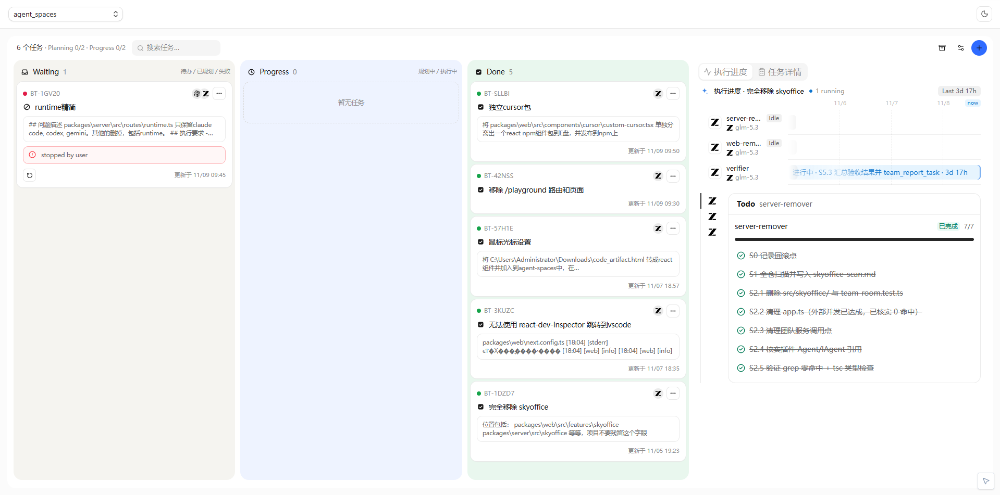

# dsh-team-control

[](#安装) [](#安装) [](LICENSE)

**一句话**：给 DeepSeek Harness 的 Agent Team 加一个独立 sidecar——成员上限可配、DAG 依赖自动派发、按成员分配 DSH 权限预设（permission presets）、成员审批转发给 Lead 决定、事件流可回放、SSE 实时面板。

**附带的工作区级「任务看板」**：同一个 sidecar 上的任务队列（`todo → planning → planned → inprogress → done / failed`），自动排队、先规划后执行，和团队编排共用一套事件流。

## 架构

sidecar 是独立 Node 进程（`bin/dsh-team.mjs`，默认只监听 `127.0.0.1:4317`），由 Host 插件按需拉起；每个成员都是一个真的 DSH 子会话。



三条链路：

- **编排**：Lead 调 `team_*` / `board_*` → Host 插件校验并绑定会话 → sidecar 写 `event`、算 DAG、推进派发。
- **成员**：`subagents.startActivation` 拉起真子会话，成员跑完用 `team_report_task` 回写 → sidecar 推进依赖、唤醒下一波。
- **观测**：面板与 CLI 走 REST + SSE，`lastEventId` 断线续传；面板构建产物由 sidecar 同源托管。

### 一轮任务怎么跑



设计取舍：

- **状态单轴**：所有变更写 `event`，`member_state` 是它的物化视图，崩溃后可完整重建。
- **权限不归 sidecar**：`permissionPreset` 落实到子会话，审批经插件转发给 Lead，`approval` 表只做镜像与审计（`team_approve` → 宿主 `allowed-once` / `rejected`）。
- **组合预设**：工具 / skill / MCP 由 `agentPreset`（DSH 组合预设）决定，团队默认、成员可覆盖；`fork` 继承 Lead 组合，`fresh` 才支持独立预设。
- **契约优先**：[`docs/CONTRACT.md`](docs/CONTRACT.md) 是实现口径，每条偏离都补一份 [`docs/adr/`](docs/adr/)。

## 截图

<p align="center">
  
  
  
  
  
  
</p>

## 安装

要求 **Node.js ≥ 22.15**（`node:sqlite` ≥22.5、Worker 的 `module.registerHooks` ≥22.15；实测 v24.22）。**零依赖、零构建**，不需要 `npm install`。

### 1. 装插件（`dsh plugin`）

```bash
# npm 包（预构建，装完即用；sidecar 以依赖 dsh-team-control-cli 一起装）
dsh plugin --profile web add dsh-team-control
dsh plugin --profile web add dsh-team-control-ui   # 可选：GUI 看板
```

```bash
# 本地开发源码
git clone https://github.com/hunmer/dsh-team-control.git ~/dsh-team-control
dsh plugin --profile web add "$HOME/dsh-team-control/dsh-plugin"
dsh plugin --profile web add "$HOME/dsh-team-control/dsh-plugin-ui"   # 可选：GUI 看板
```

装完**重启 DSH**（或到 设置 → 插件 里禁用/启用一次），`team_*` 工具与「编排」「任务看板」两个独立入口才会出现。
`dsh plugin --profile web remove dsh-team-control`（UI 包同理）。

### 2. 验证

```bash
cd ~/dsh-team-control
node demo/run-demo.mjs     # 3 成员 + DAG + 一次审批 + 一次 interrupt/resume
node tests/run-all.mjs     # AC-01 ~ AC-19 与插件/面板/路由/CLI 全量验收
```

## 示例用法

装好后直接用自然语言下任务，模型会自己调用这些工具（sidecar 首次调用时由插件自动拉起）：

```text
你：用 dsh-team 起个 3 人团队，写一篇 800 字的短文并互审。

team_create  { name: "essay", workspace: "D:/work/essay", permissionPreset: "workspace-write",
               agentPreset: "standard", maxMembers: 3 }
              → { team: { id: "team_x1" } }

team_spawn   { teamId: "team_x1", name: "writer",   role: "writer",   prompt: "你是 writer…" }
team_spawn   { teamId: "team_x1", name: "reviewer", role: "reviewer", prompt: "你是 reviewer…" }

team_task    { teamId: "team_x1", subject: "01 写初稿", assignee: "<writer 的 id>",
               acceptance: "draft.md 存在且 ≥800 字" }
team_task    { teamId: "team_x1", subject: "02 审稿", assignee: "<reviewer 的 id>",
               deps: [{ from: "<01 的 task id>", condition: "all_success" }],
               acceptance: "review.md 含 3 条以上具体意见，引用 draft.md 原句" }

成员干完各自 team_report_task({ teamId, taskId, status, summary })，
调度器按 DAG 自动派下一波；需要审批的操作会转发给 Lead，由 team_approve 放行或拒绝。

team_status  { teamId: "team_x1", detail: "dag" }   // 看成员状态与 DAG 关键路径
team_report  { teamId: "team_x1" }                  // 导出 Markdown 运行报告与审计表
```

面板：<http://127.0.0.1:4317/panel>（插件拉起 sidecar 后即可访问）。CLI 等价入口：
`npx -y dsh-team-control-cli status | dag | logs | report`。

## 文件地图

| 路径 | 作用 |
|---|---|
| `bin/dsh-team.mjs` | CLI：`up` / `down` / `status` / `dag` / `logs` / `approvals` / `report` |
| `src/core.mjs` | 组合根、业务查询、报告导出 |
| `src/db.mjs` | SQLite schema / 事务 / 轻量迁移 |
| `src/eventstore.mjs` | 事件流 `append` / `rebuild` / `verify` |
| `src/scheduler.mjs` | DAG 求值、就绪推进、失败策略、环检测 |
| `src/board.mjs` | 任务看板：状态机、并发槽位、claim / attach |
| `src/approval` 相关 | core 的 `createApproval` / `decideApproval` 镜像宿主审批 |
| `src/bus.mjs` | 持久信箱与三态回执 |
| `src/memory.mjs` | 显式记忆：一条记忆一个 JSON 文件 + CAS 写入 |
| `src/llm.mjs` | 模型路由目录（只存映射 / 开关 / 备注，不接 LLM 服务） |
| `src/sse.mjs` | SSE hub 与断线续传 |
| `src/server.mjs` | REST + SSE + 静态面板（仅回环监听） |
| `src/web/` | 面板构建产物（`panel.html` + `assets/`） |
| `src/web-ui/` | 面板源码（React + coss ui，含 Trace 瀑布） |
| `dsh-plugin/` | DSH Host bundle：20 个 `team_*` + 4 个 `board_*` 工具 + sidecar 生命周期 + 子会话成员调度 + 审批转发 |
| `dsh-plugin-ui/` | GUI 看板 bundle：better-sidebar 页签 / 侧栏入口 |
| `skills/dsh-agent-team/` | 给模型看的调用配方 skill |
| `tests/` | `ac-*.mjs` 验收脚本（AC-01 ~ AC-19）+ harness + `run-all.mjs` |
| `demo/` | `run-demo.mjs` 可复现演示、`seed.mjs` 灌演示数据 |
| `docs/` | `CONTRACT.md` 实现契约、`adr/` 决策记录、`handoffs/` 交接 |
| `prd/` | 需求文档与实现摘要 |
