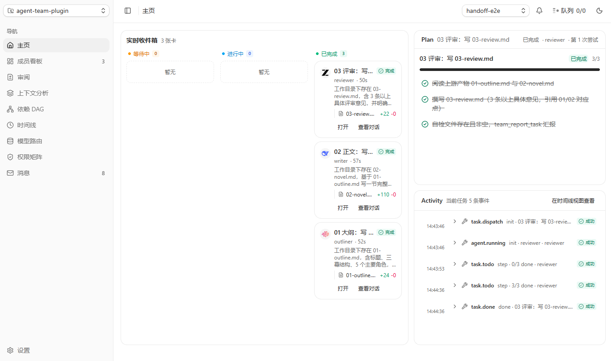
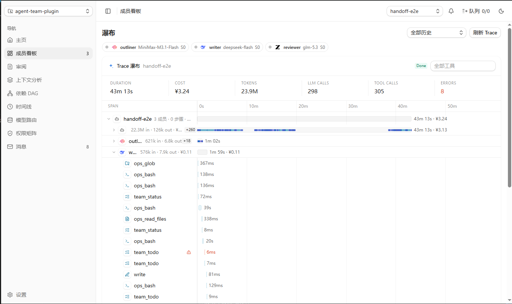
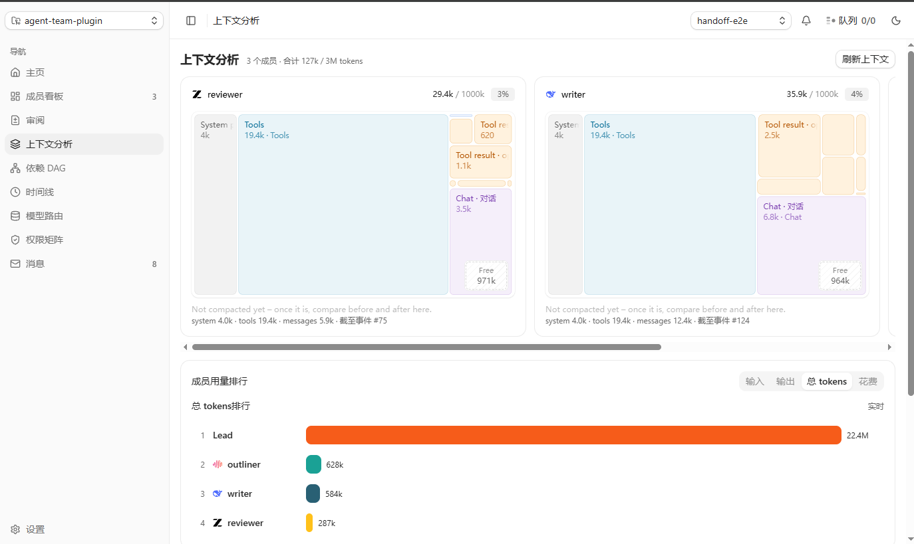
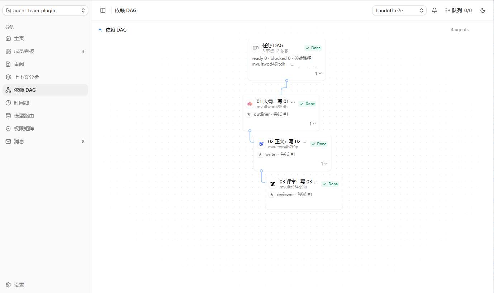
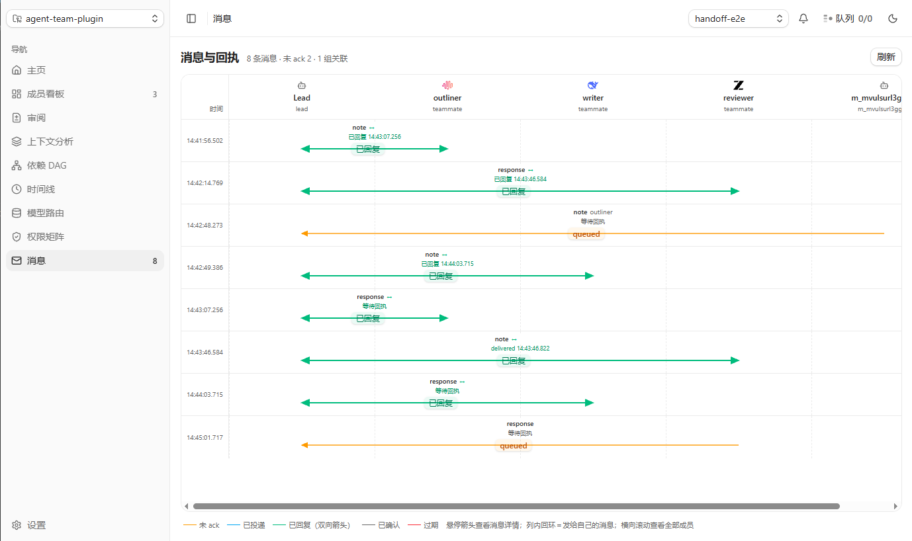

# dsh-team-control

[](#安装) [](#安装) [](LICENSE)

**一句话**：给 DeepSeek Harness 的 Agent Team 加一个独立 sidecar——成员上限可配、DAG 依赖自动派发、`fs/exec/net/env` 四域强制执行权限、事件流可回放、SSE 实时面板。

## 截图

<p align="center">
  
  
  
  
  
</p>

## 安装

要求 **Node.js ≥ 22.15**（`node:sqlite` ≥22.5、Worker 的 `module.registerHooks` ≥22.15；实测 v24.22）。**零依赖、零构建**，不需要 `npm install`。

### 1. 装插件（`dsh plugin`）

```bash
# 本地源码（推荐：sidecar 能被插件自动拉起）
git clone https://github.com/hunmer/dsh-team-control.git ~/dsh-team-control
dsh plugin --profile web add "$HOME/dsh-team-control/dsh-plugin"
dsh plugin --profile web add "$HOME/dsh-team-control/dsh-plugin-ui"   # 可选：GUI 看板
```

```bash
# GitHub 源码（免 clone；本仓库无构建脚本，不需要 allowBuilds 授权）
dsh plugin --profile web add "github:hunmer/dsh-team-control#path:/dsh-plugin"
dsh plugin --profile web add "github:hunmer/dsh-team-control#path:/dsh-plugin-ui"
```

```bash
# npm 包（预构建，装完即用；sidecar 以依赖 dsh-team-control-cli 一起装）
dsh plugin --profile web add dsh-team-control
dsh plugin --profile web add dsh-team-control-ui   # 可选：GUI 看板
```

装完**重启 DSH**（或到 设置 → 插件 里禁用/启用一次），`team_*` 工具与「编排」面板才会出现。卸载：
`dsh plugin --profile web remove dsh-team-control`（UI 包同理）。

### 2. 验证

```bash
cd ~/dsh-team-control
node demo/run-demo.mjs     # 3 成员 + DAG + 一次越界审批 + 一次 interrupt/resume
node tests/run-all.mjs     # AC-1 ~ AC-15 与插件/面板/路由/CLI 全量验收
```

## 示例用法

装好后直接用自然语言下任务，模型会自己调用这些工具（sidecar 首次调用时由插件自动拉起）：

```text
你：用 dsh-team 起个 3 人团队，写一篇 800 字的短文并互审。

team_create  { name: "essay", workspace: "D:/work/essay", runtime: "agent", maxMembers: 3 }
              → { team: { id: "team_x1" } }

team_spawn   { teamId: "team_x1", name: "writer",   role: "writer" }
team_spawn   { teamId: "team_x1", name: "reviewer", role: "reviewer" }

team_task    { teamId: "team_x1", subject: "01 写初稿", assignee: "<writer 的 id>",
               acceptance: "draft.md 存在且 ≥800 字" }
team_task    { teamId: "team_x1", subject: "02 审稿", assignee: "<reviewer 的 id>",
               deps: [{ from: "<01 的 task id>", condition: "all_success" }],
               acceptance: "review.md 含 3 条以上具体意见，引用 draft.md 原句" }

成员干完各自 team_report_task({ teamId, taskId, status, summary })，
调度器按 DAG 自动派下一波；越界动作会变成 blocked → scope 请求 → 你 approve 后单次 grant。

team_status  { teamId: "team_x1", detail: "dag" }   // 看成员状态与 DAG 关键路径
team_report  { teamId: "team_x1" }                  // 导出 Markdown 运行报告与审计表
```

面板：<http://127.0.0.1:4317/panel>（插件拉起 sidecar 后即可访问）。CLI 等价入口：
`npx -y dsh-team-control-cli status | dag | logs | report`。

## 架构

```
Lead Agent ──REST / CLI / SSE──▶ dsh-team sidecar (127.0.0.1:4317)
                                  ├ Scheduler   DAG 求值 + 自动派发
                                  ├ EventStore  event 只增流 + 状态物化
                                  ├ PermBroker  四域唯一 IO 出口 + 审计
                                  ├ MessageBus  持久信箱 + 三态回执
                                  ├ SSE Hub     lastEventId 断线续传
                                  └ Web UI      面板 /panel（Trace 瀑布 / DAG / 审批）

Worker × N    ◀──stdio NDJSON RPC────────────────┘  runtime=worker：沙箱 Node 进程，只能走 broker
DSH agent × N ◀──subagents.startActivation / sendMessage── dsh-plugin/  runtime=agent：真子会话
```

- 状态只有一根主轴：所有变更写 `event`，`member_state` 是它的物化视图，崩溃后可完整重建。
- 越界即 `blocked` → `scope_request` → 落盘 `decision` → 单次 `grant` → 重试 → `audit` 记前后 hash。
- 契约：[`docs/CONTRACT.md`](docs/CONTRACT.md)；每条偏离一份 [`docs/adr/`](docs/adr/)。

## 文件地图

| 路径 | 作用 |
|---|---|
| `bin/dsh-team.mjs` | CLI：`up` / `down` / `status` / `dag` / `logs` / `approve` / `report` |
| `src/core.mjs` | 组合根、业务查询、报告导出 |
| `src/db.mjs` | SQLite schema / 事务 / 轻量迁移 |
| `src/eventstore.mjs` | 事件流 `append` / `rebuild` / `verify` |
| `src/policy.mjs` | 四域策略纯求值器（默认拒绝、deny 优先） |
| `src/broker.mjs` | 四域唯一 IO 出口：grant、审计、CAS 写 |
| `src/scheduler.mjs` | DAG 求值、派发、并发上限、失败策略、环检测 |
| `src/runner.mjs` | Worker 子进程、租约、同步中断、崩溃恢复 |
| `src/bus.mjs` | 持久信箱与回执 |
| `src/sse.mjs` | SSE hub 与断线续传 |
| `src/server.mjs` | REST + SSE + 静态面板（仅回环监听） |
| `src/worker/worker.mjs` | 受限 Worker（单文件，仅 `import node:module`） |
| `src/web/` | 面板构建产物（`panel.html` + `assets/`） |
| `src/web-ui/` | 面板源码（React + coss ui，含 Trace 瀑布） |
| `dsh-plugin/` | DSH Host bundle：11 个 `team_*` 工具 + sidecar 生命周期 + agent 成员调度 |
| `dsh-plugin-ui/` | GUI 看板 bundle：better-sidebar 页签 / 侧栏入口 |
| `skills/dsh-agent-team/` | 给模型看的调用配方 skill |
| `tests/` | `ac-*.mjs` 验收脚本 + harness + `run-all.mjs` |
| `demo/` | `run-demo.mjs` 可复现演示、`seed.mjs` 灌演示数据 |
| `docs/` | `CONTRACT.md` 实现契约、`adr/` 决策记录、`handoffs/` 交接 |
| `prd/` | 需求文档与实现摘要 |

## 声明

- **许可**：MIT，见 [`LICENSE`](LICENSE)。
- **本地优先**：sidecar 只监听 `127.0.0.1`，`/api/**` 与 `/panel` 免 token，因此不要把端口直接暴露到公网；需要远程访问请自行套反向代理与鉴权。
- **不碰凭据**：不内置 LLM 客户端、不保存任何 API Key；敏感 env 输出一律 `<redacted>`。
- **非官方**：本项目为个人项目，与 DeepSeek 官方无隶属或背书关系。
- **取舍**：Node 无 net 权限门、状态单点存放、并发写用 CAS 等已知限制与理由见 [`docs/adr/`](docs/adr/)。
