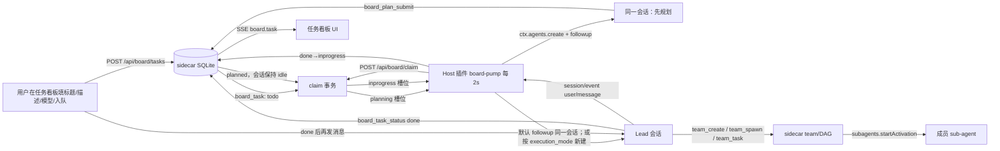

# 工作区任务看板（Workspace Task Board）可行性与实施计划

> 状态：草案 v2 · 2026-11-04（已按用户 6 点确认修订）
> 目标仓库：`/Users/Zhuanz/Documents/dsh-agent-team-plugin`
> 目标 DSH：`0.2.1-rc.2`（`/opt/homebrew/lib/node_modules/@deepseek-ai/dsh/`）
> 本文只做架构验证与实施计划，不含 UI 实现；UI 代码等用户提供后再落。

---

## 0. 结论

**可行。** DSH 的 Host 插件具备「不经过用户手动建会话，直接创建根会话并投递 prompt」的能力，且创建的会话会按 `cwd` 自动归入对应工作区。默认让**规划与执行复用同一个会话**：规划完成后不关会话，等 inprogress 槽位空出，再向同一会话投递执行 prompt；用户也可以在任务卡片上选「在新的会话执行」。关键链路：

```
Host 插件 ctx.agents.create({sessionId, meta.cwd, agentOptions, setup})
  → agent.followup(规划 prompt)
  → 模型规划，调用 board_plan_submit
  → 任务进入 planned（不关会话）
  → 等 inprogress 槽位空出，向同一会话 followup(执行 prompt)
  → 模型调用本仓库已注册的 team_* 工具
  → team_create 用 exec.agent 作为 Lead，成员走 subagents.startActivation
```

但有一个**不可绕过的架构约束**：

> **调度器必须跑在 Host 插件里，不能放 sidecar。**
> sidecar 是纯 Node 进程，没有 `ctx.agents`，无法创建 DSH 会话；它能做的是把「谁该开始、并发是否已满、状态怎么迁移」做成 SQLite 事务里的原子 claim。插件每个 tick 向 sidecar claim 一个槽位，再用 DSH 能力把会话拉起来。

另一个必须提前处理的点：

> **无人值守会话必须显式 pin 一个 `approval=never` 的权限预设**，否则默认 `ask` 会把会话挂死。本机 profile 的默认预设已是 `danger-full-access`（never），但其他机器不一定。

---

## 1. 需求拆解与现状差距

| 需求 | 现状 | 差距 |
|---|---|---|
| 每个工作区一个看板 | 已有 `workspace` 表与 Host 同步（`dsh-plugin/index.js:463`）；面板已有工作区切换器 `src/web-ui/src/components/WorkspaceSelect.tsx` | 缺 workspace 级看板数据与视图 |
| 列：todo / planning / inprogress / done / failed | 已有「成员看板」，但那是成员运行态，不是任务 | 新增「任务看板」页签，避免与成员看板重名 |
| task 里可包含多个 team | 已有 `team.lead_session_id`、`/api/teams/for-session` | 缺 task ↔ team 多对多绑定与展示 |
| todo 加任务后自动排队 | 现有 `task` 是 team 内 DAG 节点；`todo` 是成员清单 | 现有两张表都不能复用，必须新建 `board_*` |
| planning 并发可配，默认 1 | 无 | 新增 board settings 与原子 claim |
| 规划完成后自动进 inprogress，并发可配，默认 1 | 无 | 新增状态机与 claim |
| 自动创建会话并把 prompt 交给 leader | 现状必须由用户先开一个会话、发消息、模型调 `team_create` 才有 Lead | 插件主动 `ctx.agents.create` + `followup` |
| leader 调 agent team 干活 | 已有 `team_*` 14 个工具，Lead 上下文由 `exec.agent` 提供 | 创建出的根会话要能拿到 team 工具 |
| 完成后 leader 改 done；用户再发消息改回 inprogress | 无 | 新增 `board_task_status` 工具 + `session/event` 监听 |
| task 可封存 | 团队已有 archive；任务没有 | 新增 `archived_at`、恢复、活动任务先停止 |

**结论：不是在现有 DAG 上打补丁，而是新增一层「workspace 任务编排」子系统。** 现有 `src/scheduler.mjs` 继续负责 team 内 DAG；看板负责 workspace 级任务生命周期。两者通过 `team_id` 关联，互不替代。

---

## 2. 目标架构



三条边界：

1. **sidecar 是唯一状态源**：任务、并发计数、claim、状态迁移都在 SQLite 事务里完成。
2. **只有 Host 插件能创建/取消 agent**：插件持有 `AgentHandle`，sidecar 不碰进程。
3. **Lead 仍然是普通 DSH 根会话**：它用现有 `team_*` 工具，不引入 DSH 原生 Agent Teams，避免与 sidecar 的 team 概念冲突。

---

## 3. 可行性证据（DSH 源码）

### 3.1 插件可以创建根会话

Web/API 新建会话的真实路径就在 Host 进程里：

- `dsh-api-session-controller/lib/index.js:517` `createAgent()`：
  ```js
  await mkdir(cwd, { recursive: true });
  return (await this.ctx.agents.create({
    sessionId,
    agentOptions: this.agentOptions(),        // { provider, model }
    meta: { cwd, ...(composition.agentPreset ? { agentPreset } : {}) },
    setup: composition.setup,
  })).agent;
  ```
- `CreateAgentOptions`（`dsh-agent/lib/types/index.d.ts:48`）：`sessionId` 必填，`meta.cwd` 决定工作区归属，`agentOptions` 决定模型，`setup(agentCtx, agent)` 用来 mount agent preset。
- `SessionId` 只是 brandString，无格式要求；Web 用的就是 `session-${randomUUID()}`。
- `ctx.agents.create` 的 owner 是调用方 Cordis fiber。插件卸载会 dispose 句柄，但会话日志仍在，可用 `ctx.agents.resume({ resumeSessionId })` 恢复。

**结论：插件不需要 `exec.agent`，也不需要用户先开会话，就能造一个根会话。**

### 3.2 插件可以无用户投递 prompt

- `Agent.followup(input)`（`dsh-agent-loop/lib/index.js:806`）就是 `this.send(input, 'next-turn', true)`。
- `send()`（同文件 `:800`）只做 `this.inbox.splice(target, Infinity, 0, [message])`，不校验消息对象。
- 因此可以零依赖手工构造：
  ```js
  {
    id: randomUUID(),
    role: 'user',
    content: [{ type: 'text', text: prompt }],
    source: { kind: 'user' },
  }
  ```
  不需要 `import '@deepseek-ai/dsh-llm'`（本仓库 profile 里也没有这个包，直接 import 会 `ERR_MODULE_NOT_FOUND`）。

### 3.3 会话会自动出现在对应工作区

- `WorkspaceRegistry` 按 session header 的 canonical `cwd` 建索引，`list()` 返回的每个 workspace 带 `sessionIds`（`dsh-workspace/lib/index.js:454`）。
- 用 task 的 workspace 路径作为 `meta.cwd`，会话就出现在该工作区侧栏，不需要额外的「挂载会话」API。
- workspace id 是持久化的 `randomUUID()`（同文件 `:646`），跨重启稳定；但 workspace 被删除重建会换 id，所以 `board_task` 同时存 `workspace_path` 作为兜底。

### 3.4 创建出的 Lead 能拿到 `team_*` 工具

- 本仓库在根上下文 `ctx.tools.register` 注册全部 `team_*`（`dsh-plugin/index.js:2294`），默认全局可见。
- `team_create` 用 `exec.agent` 作为 Lead 并写 `lead_session_id`（`dsh-plugin/index.js:1383-1421`）；`team_spawn` 用 `exec.agent` 起 `subagents.startActivation`（`dsh-plugin/index.js:1425`）。
- 只要创建会话时正确 mount agent preset（或使用不 restrict 工具的默认 preset），Lead 就能调这些工具。

**注意**：只传 `meta.agentPreset` 不调用 `agentPresets.mount()` 等于没装组合。必须复制 API controller 的 `composeAgent` 逻辑（`dsh-api-session-controller/lib/index.js:371`）：

```js
const resolved = presetId ? await presets.resolve(presetId) : undefined;
const composition = {
  agentPreset: resolved?.id,
  setup: async (agentCtx, agent) => {
    if (resolved) {
      await presets.mount(agentCtx, resolved.id);
      agent.session.append('agent-preset/selected', { agentPreset: resolved.id });
    }
  },
};
```

### 3.5 会话权限可以显式 pin

- `ctx.permissionPresets.set(session, name)` 会写 `permission/preset` 与 sandbox/approval knob；`defaultPreset` 在会话发布时 pin 初始权限。
- 本机 profile `/Users/Zhuanz/.dsh/profiles/web/cordis.patch.yml`：
  - `read-only` → read-only / ask
  - `workspace-write` → workspace-write / ask
  - `danger-full-access` → danger-full-access / never
  - `defaultPreset: danger-full-access`
  - `agent-default-model: deepseek-official/deepseek-flash`
- 无人值守的规划会话**建议**选 `approval=never` 的预设；但本机只有 `danger-full-access` 是 never。规划默认 `read-only` + ask，因此插件必须把**仍处于规划阶段**的看板会话的 `approval/request` 自动拒绝（按 sessionId + `phase='planning'` 判断），否则会挂死。规划 prompt 明确禁止写文件，正常不会触发；同一会话切到执行前会改成 `danger-full-access`，执行期不再拦截。

### 3.6 生命周期与恢复

- 插件 `apply(ctx)` 在 DSH 启动时执行，早于任何用户会话；后台 pump 可以直接跑。
- 插件已有 `ctx.effect(() => { timer = setInterval(...); timer.unref?.(); return () => clearInterval(timer); })` 的模式（`agent-pump` / `workspace-pump`），board pump 复用。
- 插件重载/DSH 重启后，`AgentHandle` 失效，但 session 日志还在。看板任务不能假装还在跑：M4 做「活动任务失去 live session」的标记与重试入口。

### 3.7 备选：规划阶段不建会话，直接调模型

如果希望严格按「规划完成后才创建会话」的字面语义，插件也可以不建 planning 会话，而是直接调 Host 的 LLM：

```js
const stream = ctx.llm.stream({
  provider, model,
  system: '你是只做规划的 Agent，不写代码。',
  messages: [{ role: 'user', content: [{ type: 'text', text: planningPrompt }] }],
  maxTokens: 8000,
});
let plan = '';
for await (const chunk of stream) {
  if (chunk.type === 'text-delta') plan += chunk.text;
  if (chunk.type === 'finish' && chunk.reason !== 'stop') throw new Error(chunk.reason);
}
```

`GenerateOptions` / `StreamChunk` 见 `dsh-llm/lib/types/types.d.ts:506` 与 `:434`；`LlmRuntime.stream` 是公开服务方法。优点：只开一个 Lead 会话、规划便宜快；缺点：**没有文件读取/搜索工具**，只能根据标题和描述规划，无法给出文件级步骤。若仓库不大，可以把 README / 目录树塞进 prompt 缓解，但不如规划会话可靠。

用户已确认默认采用「同一会话先规划、后执行」（3.1–3.6），因此本方案只作为未来可选优化：若某类任务不需要读文件，可跳过规划会话、直接建 Lead 会话。

### 3.8 运行时验证（尚未做）

以上是源码级验证。真正的运行时验证放在 M1：建一张 `board_task`、一个 claim 接口、一个最小 pump，创建一条「请回复 OK」的 planning 会话，确认：

1. 会话出现在目标工作区；
2. `followup` 后模型真的开始跑；
3. 会话内能调 `board_plan_submit`；
4. 插件重启后不会重复建会话。

M1 通过之前，不写 UI。

---

## 4. 设计决策

| # | 决策 | 理由 |
|---|---|---|
| D1 | **默认：规划与执行复用同一个会话**；任务卡片另提供「在新的会话执行」，用 `execution_mode` 区分 | 用户确认。规划会话已经读过文件、有上下文，直接续聊最省会话；想隔离时再新建 Lead 会话 |
| D2 | 内部状态 6 个：`todo → planning → planned → inprogress → done/failed` | 规划完成后必须释放 planning 槽位，否则并发=1 时后续任务永远排不进来；`planned` 是「等 inprogress 槽位」 |
| D3 | UI 只显示 3 列：**Waiting / Progress / Done**；Waiting 内再区分 `todo`、`planned`、`failed` | 用户确认。Waiting = 待处理（含待执行计划、失败待重试），Progress = `planning` + `inprogress`，Done = `done` |
| D4 | 队列开关 `auto=0/1`，默认 `0` | 用户确认。`auto=0` 留在 todo，必须点「开始执行」；`auto=1` 调度器才可自动 claim。新建任务弹窗的「自动进入队列」开关只决定初始值 |
| D5 | 并发按 workspace 计 | 每个工作区独立 `planning_concurrency` / `inprogress_concurrency`，默认 1/1 |
| D6 | 并发控制用 sidecar 原子 claim，不用 sidecar 定时器 | 插件是唯一能建 agent 的一方；claim 事务保证多窗口/多 Host 不重复派发 |
| D7 | task ↔ team 多对多，Lead 每建一个 team 就自动绑定 | 一个任务可以拆多个团队；绑定由 `team_create` 时按 `lead_session_id` 反查完成 |
| D8 | `team_models` 是成员模型白名单 | 空数组 = 不限制；非空时 `team_spawn` 校验 provider/model，越界直接拒绝；省略路由时取白名单第一条 |
| D9 | 完成/失败由 Lead 调 `board_task_status` 主动上报 | 符合需求；UI 另提供手动兜底，避免 Lead 忘记 |
| D10 | 封存 = `archived_at`，不删数据 | 可恢复；活动任务先 stop 再 archive，用户确认 |
| D11 | 同一会话模式下，会话模型固定为 `plan_*`（没有则回退 `lead_*` → Host 默认）；`lead_*` 只在 `execution_mode='new'` 时用于新会话 | DSH 没有公开的会话中途换模型 API；规划与执行共用会话就必然共用模型。若要严格分开规划/执行模型，选「在新的会话执行」 |

---

## 5. 数据模型（schema v12）

新增 4 张表，全部 `board_` 前缀，不动现有 `task` / `todo`。

```sql
CREATE TABLE IF NOT EXISTS board_settings (
  workspace_id TEXT PRIMARY KEY,
  workspace_path TEXT NOT NULL,
  planning_concurrency INTEGER NOT NULL DEFAULT 1,
  inprogress_concurrency INTEGER NOT NULL DEFAULT 1,
  plan_provider TEXT, plan_model TEXT, plan_effort TEXT,
  lead_provider TEXT, lead_model TEXT, lead_effort TEXT,
  plan_permission_preset TEXT NOT NULL DEFAULT 'read-only',
  lead_permission_preset TEXT NOT NULL DEFAULT 'danger-full-access',
  plan_agent_preset TEXT,
  lead_agent_preset TEXT,
  updated_at TEXT NOT NULL
);

CREATE TABLE IF NOT EXISTS board_task (
  id TEXT PRIMARY KEY,
  workspace_id TEXT NOT NULL,
  workspace_path TEXT NOT NULL,
  title TEXT NOT NULL,
  description TEXT NOT NULL DEFAULT '',
  status TEXT NOT NULL DEFAULT 'todo'
    CHECK (status IN ('todo','planning','planned','inprogress','done','failed')),
  auto INTEGER NOT NULL DEFAULT 0 CHECK (auto IN (0,1)),
  execution_mode TEXT NOT NULL DEFAULT 'same'
    CHECK (execution_mode IN ('same','new')),
  priority INTEGER NOT NULL DEFAULT 0,
  position INTEGER NOT NULL DEFAULT 0,
  plan_provider TEXT, plan_model TEXT, plan_effort TEXT,
  team_models_json TEXT NOT NULL DEFAULT '[]',
  plan_md TEXT,
  plan_summary TEXT,
  planning_session_id TEXT,
  lead_session_id TEXT,
  claim_token TEXT,
  claimed_at TEXT,
  stop_requested INTEGER NOT NULL DEFAULT 0,
  resumed INTEGER NOT NULL DEFAULT 0,
  last_error TEXT,
  archived_at TEXT,
  done_at TEXT,
  created_at TEXT NOT NULL,
  updated_at TEXT NOT NULL
);
CREATE INDEX IF NOT EXISTS idx_board_task_ws
  ON board_task(workspace_id, archived_at, status, priority DESC, position);
CREATE INDEX IF NOT EXISTS idx_board_task_planning_session
  ON board_task(planning_session_id);
CREATE INDEX IF NOT EXISTS idx_board_task_lead_session
  ON board_task(lead_session_id);

CREATE TABLE IF NOT EXISTS board_task_team (
  task_id TEXT NOT NULL,
  team_id TEXT NOT NULL,
  created_at TEXT NOT NULL,
  PRIMARY KEY (task_id, team_id)
);
CREATE INDEX IF NOT EXISTS idx_board_task_team_team ON board_task_team(team_id);

CREATE TABLE IF NOT EXISTS board_event (
  id INTEGER PRIMARY KEY AUTOINCREMENT,
  task_id TEXT NOT NULL,
  kind TEXT NOT NULL,
  payload_json TEXT NOT NULL DEFAULT '{}',
  ts TEXT NOT NULL
);
CREATE INDEX IF NOT EXISTS idx_board_event_task ON board_event(task_id, id);
```

迁移：`src/db.mjs` 的 `SCHEMA_VERSION` 从 11 升到 12；现有迁移是「建表 + `meta.schema_version` 更新」，新表用 `CREATE TABLE IF NOT EXISTS`，不需要 `ALTER`。

字段说明：

- `workspace_path` 冗余存一份，workspace 被删除重建（id 变化）时还能按路径找回。
- `plan_*` / `lead_*` 在 task 上是覆盖值；为空时继承 `board_settings`，再为空则用 Host 默认模型。`execution_mode='same'` 时整条会话用 `plan_*` 路由（没有则回退 `lead_*`），`lead_*` 只对 `execution_mode='new'` 生效。
- `planning_session_id` / `lead_session_id` 是工具反查任务的索引。`execution_mode='same'` 时两者是同一个 session：plan submit 后把 `lead_session_id` 也写成它；`new` 时 `lead_session_id` 在执行 attach 时才写。
- `auto=0` 的任务不会被 claim；用户点「开始执行」/「在新的会话执行」时置 1。
- `claim_token` 是 fencing token：claim 后如果任务被用户改了状态，attach 会失败，插件随即 dispose 刚建的 agent。

---

## 6. 状态机与调度规则

```text
todo ──claim(planning, auto=1)──► planning ──plan submitted──► planned
  ▲                                    │                          │
  │                                    ├─ fail/timeout ──► failed │
  │                                    └─ cancel ────────► todo   │
  └──────── retry ◄──────────────────── failed ◄──── stop ────────┤
                                                                  │
planned ──claim(inprogress)──► inprogress ──lead done──► done
                                   │                       │
                                   └── lead failed ──► failed
done ──user message──► inprogress（仅未封存）
```

规则：

1. **claim(planning)**：在同一个 `BEGIN IMMEDIATE` 事务里，遍历有 settings 的 workspace；若该 workspace `COUNT(status='planning') < planning_concurrency`，取 `status='todo' AND auto=1 AND archived_at IS NULL` 中 `priority DESC, position ASC, created_at ASC` 的第一条，改成 `planning`，写 `claim_token`，返回任务 + workspace + settings。
2. **claim(inprogress)**：同理，取 `status='planned'` 的第一条，改成 `inprogress`，返回任务 + `execution_mode` + `planning_session_id`。
3. **plan submit**：按 `planning_session_id` 找到 `status='planning'` 的任务，写 `plan_md` / `plan_summary`，改成 `planned`；若 `execution_mode='same'`，同时把 `lead_session_id` 写成该 session，清空 claim。**不关闭会话**，让它 idle 等槽位。
4. **执行派发**：claim 到 `inprogress` 后：
   - `execution_mode='same'`：不建新会话；把该 session 的权限切到 `lead_permission_preset`，向同一 session `followup` 执行 prompt。若 session 不在了，任务回 `failed`（`session_not_live`），提示 retry/在新的会话执行。
   - `execution_mode='new'`：新建 Lead 会话，attach 后 `followup`；原规划会话可保留（默认保留，不占槽位）。
5. **lead done**：按 `lead_session_id` 找到 `status IN ('inprogress','planned')` 的任务，改成 `done`，写 `done_at`。
6. **lead failed**：改成 `failed`，写 `last_error`。
7. **用户再发消息**：`lead_session_id` 匹配且 `status='done'`（可选也允许 `failed`）且未封存 → 改回 `inprogress`，清 `last_error`。这是用户手动续聊，**不受并发槽位限制**；它会占用一个 inprogress 计数，pump 因此暂停给新任务发槽。
8. **start（卡片「开始执行」）**：`auto=1`；`status='todo'` 时等 planning claim；`status='planned'` 时等 inprogress claim。`mode='new'` 时同时写 `execution_mode='new'`。
9. **stop**：用户主动停止 → `failed`，`last_error='stopped_by_user'`；插件取消并 dispose 对应 agent。`execution_mode='same'` 只 dispose 那一个会话；`new` 时 dispose Lead，规划会话保留。
10. **archive**：仅允许 `todo/done/failed`；`planning/planned/inprogress` 返回 409，要求先 stop。archive 只写 `archived_at`，不改 status。
11. **retry**：`failed`/`done` → `planned`（已有 plan）或 `todo`（无 plan）；清 `last_error`、`planning_session_id`、`lead_session_id`，保留 team 绑定作为历史。done 的「再次执行」走这里，不覆盖原 plan；默认仍沿用原来的 `execution_mode`，用户可改。
12. **超时**：planning 超过插件配置 `boardPlanningTimeoutMs`（默认 30 分钟）→ `failed`，`last_error='planning_timeout'`。Lead 不设自动超时（用户可能在对话）。

并发计数只算 `planning` / `inprogress`；`planned` 不占任何槽位。

---

## 7. REST 与 SSE

所有接口挂在 sidecar `src/server.mjs`，沿用 `createRoutes(core)` 的数组风格与统一错误结构。

### 7.1 公开接口

| 方法 | 路径 | 说明 |
|---|---|---|
| `GET` | `/api/board?workspaceId=&archived=0` | 返回 `{ settings, items, counts: {todo,planning,planned,inprogress,done,failed}, slots: {planning:{used,max}, inprogress:{used,max}} }` |
| `GET` | `/api/board/tasks/{id}` | 任务详情，含 teams 与最近事件 |
| `POST` | `/api/board/tasks` | `{workspaceId, title, description?, auto?, executionMode?, priority?, planProvider?, planModel?, planEffort?, teamModels?}` |
| `PATCH` | `/api/board/tasks/{id}` | 改标题/描述/模型/队列/优先级；不改状态 |
| `POST` | `/api/board/tasks/{id}/start` | `{mode?: 'same'\|'new'}`；置 `auto=1`，可改 `execution_mode`。todo 走规划，planned 直接等执行 |
| `POST` | `/api/board/tasks/{id}/stop` | 活动任务 → failed + `stop_requested` |
| `POST` | `/api/board/tasks/{id}/retry` | failed → planned/todo |
| `POST` | `/api/board/tasks/{id}/reset` | failed/done → `todo`，清空计划、会话绑定与失败信息（需手动 start） |
| `POST` | `/api/board/tasks/{id}/archive` | 终态任务封存 |
| `POST` | `/api/board/tasks/{id}/restore` | 取消封存 |
| `POST` | `/api/board/tasks/{id}/status` | 手动兜底：`{status:'done'\|'failed'\|'inprogress'}` |
| `GET` | `/api/board/tasks/{id}/session` | 返回 `{planningSessionId, leadSessionId, executionMode}`，UI 用来显示「打开规划会话 / 打开 Lead 会话」 |
| `GET` | `/api/board/settings?workspaceId=` | 读设置（无记录返回默认值） |
| `PUT` | `/api/board/settings` | 写设置 `{workspaceId, workspacePath, planningConcurrency, inprogressConcurrency, ...}` |
| `GET` | `/api/board/live` | 插件对账：`planning/planned/inprogress`，以及仍有 lead 会话的 done/failed；含 sessionId、`archived_at`、`stop_requested` |

### 7.2 插件内部接口（同样走 HTTP，靠 loopback 保护）

| 方法 | 路径 | 说明 |
|---|---|---|
| `POST` | `/api/board/claim` | `{kind:'planning'\|'inprogress', owner}` → `{item:{task, workspace, settings, claimToken}}` 或 `{item:null}` |
| `POST` | `/api/board/tasks/{id}/attach` | `{kind, sessionId, claimToken}` → 绑定 session，清 claim |
| `POST` | `/api/board/tasks/{id}/release` | `{kind, error}` → planning 回 failed / inprogress 回 failed |
| `POST` | `/api/board/agents/plan` | `{sessionId, plan, summary}` → planned |
| `POST` | `/api/board/agents/status` | `{sessionId, status, summary?}` → done/failed/inprogress |
| `GET` | `/api/board/by-session/{sessionId}` | 工具反查任务（`board_plan_submit` / `board_task_status` 用） |
| `POST` | `/api/board/tasks/{id}/teams` | `{teamId}` → 绑定 team（`team_create` 调） |
| `GET` | `/api/board/by-team/{teamId}` | 工具反查任务（`team_spawn` 校验模型白名单） |

### 7.3 SSE

新增帧：

```
event: board.task
data: { "type":"board.task", "task": {...}, "at": "<ISO>" }
```

在任务创建、claim、attach、submit、状态变更、archive 时广播。UI 收到后刷新当前 workspace 的看板；断线时退回 5s 轮询。

---

## 8. Host 插件调度器

### 8.1 新增配置

```js
boardEnabled: true,              // 总开关；关闭后看板只读
boardDispatchMs: 2000,           // pump 周期
boardPlanningTimeoutMs: 30*60_000,
boardIdleGraceMs: 5000,          // planning agent idle 后等待再判失败
boardOwner: randomUUID(),        // 本进程 claim owner（fencing）
```

### 8.2 pump 伪代码

```js
let pumping = false;
const boardSessions = new Map();   // sessionId → { taskId, phase:'planning'|'execution', handle, sawRunning }
const boardSessionIds = new Set(); // 审批自动拒绝与重启对账用

async function boardPump() {
  if (pumping || !s.boardEnabled) return;
  pumping = true;
  try {
    // 用 ctx.get 而不是 ctx.agents：插件没有 inject 'agents'，属性访问会抛
    // "cannot get property without inject"；get 返回服务实例，create 的 owner
    // 是服务提供方（agent-loop），句柄仍由本插件保存并主动 dispose。
    const agents = ctx.get('agents');
    if (!agents) return;                     // 非 Host 环境，静默跳过
    for (const kind of ['planning', 'inprogress']) {
      const claim = await post('/api/board/claim', { kind, owner: s.boardOwner });
      if (!claim?.item) continue;
      if (kind === 'planning') await spawnPlanningSession(agents, claim.item);
      else await dispatchExecution(agents, claim.item);
    }
    await reconcileLive();                   // 处理 archived / stop_requested
  } finally {
    pumping = false;
  }
}

async function spawnPlanningSession(agents, { task, workspace, settings, claimToken }) {
  // 同一会话模式：规划会话就是之后的 Lead 会话，模型固定用 plan 路由
  const route = pickRoute('planning', task, settings)
    || ctx.get('agentDefaultModel')?.currentSelection?.();
  const presetId = settings.plan_agent_preset;
  const presets = ctx.get('agentPresets');
  const resolved = presetId ? await presets?.resolve(presetId) : undefined;
  const sessionId = `session-${randomUUID()}`;

  let handle;
  try {
    fs.mkdirSync(workspace.path, { recursive: true });
    handle = await agents.create({
      sessionId,
      agentOptions: route,
      meta: { cwd: workspace.path, ...(resolved ? { agentPreset: resolved.id } : {}) },
      setup: async (agentCtx, agent) => {
        if (resolved) {
          await presets.mount(agentCtx, resolved.id);
          agent.session.append('agent-preset/selected', { agentPreset: resolved.id });
        }
      },
    });
    await setPermission(handle.agent.session, settings.plan_permission_preset);

    // 先 attach，后投 prompt：工具回调时必须能按 sessionId 反查到任务
    await post(`/api/board/tasks/${task.id}/attach`, { kind: 'planning', sessionId, claimToken });
    handle.agent.followup(boardMessage(buildPlanningPrompt(task, workspace, settings)));
    boardSessions.set(sessionId, { taskId: task.id, phase: 'planning', handle, sawRunning: false });
    boardSessionIds.add(sessionId);
  } catch (err) {
    handle?.dispose?.().catch(() => {});
    await post(`/api/board/tasks/${task.id}/release`, { kind: 'planning', error: String(err) }).catch(() => {});
  }
}

async function dispatchExecution(agents, { task, workspace, settings, claimToken }) {
  const prompt = buildLeadPrompt(task, workspace, settings);
  const same = task.execution_mode === 'same';

  if (same) {
    const sessionId = task.planning_session_id;
    const rec = boardSessions.get(sessionId);
    const agent = rec?.handle.agent ?? agents.get?.(sessionId);
    if (!agent) {
      await post(`/api/board/tasks/${task.id}/release`, {
        kind: 'inprogress', error: 'session_not_live',
      }).catch(() => {});
      return;
    }
    try {
      // 同一会话从「规划只读」切到「Lead 可写」；必须在投执行 prompt 前完成
      await setPermission(agent.session, settings.lead_permission_preset);
      await post(`/api/board/tasks/${task.id}/attach`, { kind: 'inprogress', sessionId, claimToken });
      agent.followup(boardMessage(prompt));
      if (rec) { rec.phase = 'execution'; rec.sawRunning = false; }
      else boardSessions.set(sessionId, { taskId: task.id, phase: 'execution', agent, sawRunning: false });
    } catch (err) {
      await post(`/api/board/tasks/${task.id}/release`, { kind: 'inprogress', error: String(err) }).catch(() => {});
    }
    return;
  }

  // execution_mode='new'：新建 Lead 会话，规划会话保留
  await spawnLeadSession(agents, { task, workspace, settings, claimToken }, prompt);
}

async function spawnLeadSession(agents, { task, workspace, settings, claimToken }, prompt) {
  const route = pickRoute('lead', task, settings)
    || ctx.get('agentDefaultModel')?.currentSelection?.();
  const resolved = settings.lead_agent_preset
    ? await ctx.get('agentPresets')?.resolve(settings.lead_agent_preset)
    : undefined;
  const sessionId = `session-${randomUUID()}`;
  let handle;
  try {
    handle = await agents.create({
      sessionId,
      agentOptions: route,
      meta: { cwd: workspace.path, ...(resolved ? { agentPreset: resolved.id } : {}) },
      setup: async (agentCtx, agent) => {
        if (!resolved) return;
        await ctx.get('agentPresets').mount(agentCtx, resolved.id);
        agent.session.append('agent-preset/selected', { agentPreset: resolved.id });
      },
    });
    await setPermission(handle.agent.session, settings.lead_permission_preset);
    await post(`/api/board/tasks/${task.id}/attach`, { kind: 'inprogress', sessionId, claimToken });
    handle.agent.followup(boardMessage(prompt));
    boardSessions.set(sessionId, { taskId: task.id, phase: 'execution', handle, sawRunning: false });
    boardSessionIds.add(sessionId);
  } catch (err) {
    handle?.dispose?.().catch(() => {});
    await post(`/api/board/tasks/${task.id}/release`, { kind: 'inprogress', error: String(err) }).catch(() => {});
  }
}

function boardMessage(text) {
  return { id: randomUUID(), role: 'user', content: [{ type: 'text', text }], source: { kind: 'user' } };
}

async function setPermission(session, preset) {
  if (!preset) return;
  try { ctx.get('permissionPresets')?.set(session, preset); }
  catch (err) { log(`board: unknown permission preset "${preset}": ${err}`); }
}

要点：

- **attach 在 followup 之前**，否则 Lead 第一次调工具可能查不到任务。
- **同一会话模式不新建 Lead**：sidecar 在 `board_plan_submit` 内直接 claim 执行槽位并 attach 回原 session，插件只切权限，不再 `followup`。只有槽位满、任务留在 `planned` 时，泵 claim 后才给原 session 补一条「现在开始执行」。
- **权限切换要在执行 prompt 之前**：`setPermission` 内部对未知 preset 只记日志并降级，不让任务失败。
- claim 返回 `{item:null}` 时不建会话，不记错误。
- 创建/attach 失败必须 `release`，否则槽位永久占用；同会话模式下 session 不在则回 `failed`，由用户 retry 或改「在新的会话执行」。
- `agents.create` 之前 `fs.mkdirSync(workspace.path, {recursive:true})`，与 API controller 一致；路径不存在会直接抛。
- 没有 `agentPresets` 服务时，`resolved` 为 undefined，直接创建；工具是否可见取决于 Host 默认 preset。
- 任务/工作区都没配模型时，用 `ctx.get('agentDefaultModel').currentSelection()` 兜底（与 Web 新建会话一致）。
- 同一会话模式只用 `plan_*` 路由，因为 DSH 没有公开的会话中途换模型 API；要分开模型就选 `execution_mode='new'`。

### 8.3 事件监听

```js
ctx.on('session/event', (session, event) => {
  if (event.type !== 'user/message') return;
  if (event.data?.source?.kind !== 'user') return;
  // 不依赖内存 map：sidecar 按 lead_session_id 反查，只对 done/failed 生效。
  // 首次注入的 prompt 此时任务已是 inprogress，是 no-op；插件重启后也仍然有效。
  void post('/api/board/agents/status', { sessionId: session.id, status: 'inprogress' });
});

ctx.on('agent/status', ({ agent, status }) => {
  const rec = boardSessions.get(agent.id);
  if (!rec) return;
  if (status === 'running') rec.sawRunning = true;
  if (status === 'idle' && rec.sawRunning && rec.phase === 'planning') {
    // 给工具调用/收尾留时间；仍没有 plan 就判失败，释放槽位
    setTimeout(() => failPlanningIfStillPlanning(rec), s.boardIdleGraceMs).unref?.();
  }
});

// 只有「phase === 'planning'」的看板会话才自动拒绝审批；
// 同一会话切到 execution 后不再拦截，否则会把 Lead 的正常审批也拒掉。
ctx.on('approval/request', async (req, next) => {
  const rec = boardSessions.get(req.session.id);
  if (rec?.phase !== 'planning') return next();
  log(`board: auto-deny approval in planning session ${req.session.id}`);
  return 'rejected';
});
```

### 8.4 对账

`GET /api/board/live` 返回活动任务。pump 每轮：

- 任务已 `archived` 或有 `stop_requested`：取消并 `dispose` 对应 agent，调 `release/stop`。
- `planning` 且 `claimed_at` 超过 `boardPlanningTimeoutMs`：调 `/api/board/agents/status` 置 `failed`（`planning_timeout`），再取消 agent。
- `board_plan_submit` 成功后：
  - `execution_mode='same'`：sidecar 在保存计划时**直接 claim inprogress 槽位并 attach 回规划会话**（`lead_session_id` 就是同一个 session），返回 `inprogress`；插件只把权限切到 `leadPermissionPreset`，同一个回合继续执行，不补发任何 prompt。执行槽位满时任务留在 `planned`，等泵 claim 后再走同会话 attach + 一条「现在开始执行」。
  - `execution_mode='new'`：5s 后 `dispose` 规划会话并移出 `boardSessions`；计划已存 sidecar，新 Lead 会话会重新拿到计划。
- 侧车里有 `lead_session_id`，但 `boardSessions` 没有、且 `ctx.agents.get(id)` 也不存在：标记 `last_error='session_not_live'`，UI 显示「会话已断开，可重试」。不自动重建，避免重复干活。

### 8.5 重启语义

- 插件/DSH 重启后，`boardSessions` 清空，活动任务不会被自动续跑。
- `planning` 且没有 live session 的任务：下一轮 pump 标 `failed`，`last_error='session_not_live'`；用户可以 retry。
- `inprogress` 且没有 live session 的任务：`same` 模式回 `failed`（`session_not_live`），用户可 retry 或点「在新的会话执行」；`new` 模式同样回 `failed`，但可 retry 重建。
- 这是 MVP 的明确限制，不假装能无缝恢复。

---

## 9. Prompt 设计

### 9.1 规划 prompt

```text
你是「{title}」的规划 Agent。{same ? "这一轮先只做规划" : "只做规划"}，不写代码、不修改文件、不创建团队。
{same ? "计划提交后读取 board_plan_submit 的返回：status 是 inprogress 就直接在同一会话里按计划开始执行（此时可以写文件、可以调用 team_*）；status 是 planned 说明执行槽位已满，立刻停下等待调度器。" : "规划完成后不要开始执行；调度器会在执行槽位空出后，在同一会话里让你继续。"}

开始规划前，先加载 `dsh-agent-team` 技能（调用 skill 工具，参数 {"name":"dsh-agent-team"}），按技能里的团队编排流程、成员拆分与工具字段执行，不要凭记忆猜参数。

工作区：{workspace.path}
任务描述：
{description}

可用模型（成员分配只能从这里选）：
{teamModels 列表，或「不限制」}

请先阅读必要文件，然后输出一份可执行计划，必须包含：
1. 目标与验收标准
2. 实施步骤（到文件/模块级）
3. 团队与成员建议（每个成员的角色、模型、依赖关系；按能力域合并，同一模块或相邻功能优先交给同一个成员，能一人完成就不要拆成多人）
4. 风险与回滚

最后必须调用 board_plan_submit({ plan: "<完整 markdown>", summary: "<一句话>" })。
{same ? "（同会话模式在调用要求后附一句「返回 inprogress 就按下面规则继续执行」并接上 Lead 的执行规则，不再补发第二条 prompt）" : "不要只把计划写在回复里。提交后停下，等待执行指令。"}
```

### 9.2 Lead prompt

```text
你是任务「{title}」的 Lead。工作区：{workspace.path}
{sameSession ? "你刚刚在同一会话完成了规划，现在开始执行。" : "以下是规划会话产出的计划，现在开始执行。"}

任务描述：
{description}

已确认的计划：
{plan_md}

开始执行前，先加载 `dsh-agent-team` 技能（调用 skill 工具，参数 {"name":"dsh-agent-team"}），按技能里的团队编排流程、工具字段与常见错法执行，不要凭记忆猜参数。

规则：
1. 先调用 team_create 创建团队；name 用任务标题，workspace 用上面的路径。需要多个团队就多次创建，所有团队都会自动绑定到本任务。
2. 调用 team_models 查看可用路由；只能使用以下模型：{teamModels}。为空表示不限制。
3. 用 team_task 拆解并派发；用 team_status / team_report 跟踪。不要自己写代码，不要重复成员的工作。
4. 每轮结束前必须先调用 board_task_status 对齐状态：全部任务成功→done（附完成摘要），失败→failed（附原因），仍需继续或等待用户→inprogress。不能只在开始时调用一次。
5. 用户再次发消息时，先调用 board_task_status({ status: "inprogress" })，再继续处理。
```

Prompt 里不塞完整历史，只塞任务与计划；文件内容让模型自己读。

`sameSession` 分支只在**执行槽位已满**、任务被泵从 `planned` 领走时使用；正常 same 流程在提交计划时就已经 attach，不会发这条 prompt。

---

## 10. 工具扩展

### 10.1 新增 2 个工具

| 工具 | 作用域 | 行为 |
|---|---|---|
| `board_plan_submit` | 规划会话 | `{plan, summary}`；按 `exec.agent.session.id` 反查 `planning_session_id`，调 `/api/board/agents/plan`。`execution_mode='same'` 时 sidecar 在保存计划的同时 claim 执行槽位并 attach 回同一个 session（返回 `inprogress`），插件据此切权限、同一回合继续执行；槽位满则返回 `planned`，等泵接管。不在规划会话里调用则报错 |
| `board_task_status` | Lead 会话 | `{status:'done'\|'failed'\|'inprogress', summary?}`；按 `lead_session_id` 反查，调 `/api/board/agents/status`。`same` 模式下与规划是同一个会话 |

两个工具都只允许在对应会话里用，避免普通会话误改看板。

### 10.2 改造 2 个现有工具

- `team_create`：创建成功后，如果 `exec.agent.id` 对应某个 `board_task.lead_session_id`，调 `POST /api/board/tasks/{id}/teams` 绑定。
- `team_spawn`：如果 `exec.agent.id` 对应看板任务且 `team_models` 非空，校验请求的 `{provider, model}` 在白名单内；不在则返回明确错误。**省略 provider/model 时取白名单第一条**，避免继承 Lead 的非白名单模型。这样模型白名单不是只靠 prompt。

### 10.3 为什么不给用户加工具

看板操作走 REST/UI；工具只给规划 Agent 和 Lead 用，避免用户的普通会话误触。

---

## 11. UI 计划

现有面板已经有：工作区切换器（`WorkspaceSelect`）、hash 路由（`#/w/<workspaceId>/t/<teamId>/<tab>`）、SSE、React 19 + Tailwind + coss ui。**不新建前端工程**，在 `src/web-ui` 里加一个页签。

### 11.1 命名

- 现有 `board` 页签是「成员看板」，保持不变。
- 新页签 id `tasks`，label「任务看板」，视图 `src/web-ui/src/views/TaskBoard.tsx`。
- 路由：`#/w/<workspaceId>/tasks`；不需要选中 team。

### 11.2 页面结构

```
┌ 任务看板   [工作区 ▾]   planning 0/1 · inprogress 0/1   [+ 新建任务] [⚙] ┐
│ Waiting (5)                  │ Progress (1)          │ Done (12)        │
│ ┌──────────────────────────┐ │ ┌───────────────────┐ │ ┌──────────────┐ │
│ │ [todo] 卡片              │ │ │ [planning] 卡片   │ │ │ 卡片         │ │
│ │ [planned] 卡片           │ │ │ [inprogress] 卡片 │ │ │              │ │
│ │ [failed] 卡片            │ │ │                   │ │ │              │ │
│ └──────────────────────────┘ │ └───────────────────┘ │ └──────────────┘ │
└────────────────────────────────────────────────────────────────────────┘
```

- **Waiting**：`todo`、`planned`、`failed`，每张卡片左上角用小徽标显示具体状态。
- **Progress**：`planning`、`inprogress`。
- **Done**：`done`（封存的不显示，可在筛选里打开）。
- 顶部仍显示两个并发槽位；`planned` 不占槽位。

卡片字段：标题、描述摘要、状态徽标、`auto` 开关、`planModel` / `teamModels` 徽标、绑定 team 数、更新时间、失败原因。

卡片操作：

- todo（auto=0）：**【开始执行】**（默认同会话）、**【在新的会话执行】**、编辑、封存
- todo（auto=1）：取消自动排队（置 auto=0）、编辑
- planning：打开规划会话、停止
- planned：**【开始执行】**（复用规划会话）、**【在新的会话执行】**（新建 Lead 会话）、查看计划、停止
- inprogress：打开 Lead 会话、查看团队、标记完成、停止
- failed：重试、**【在新的会话执行】**、封存
- done：再次执行、封存
- 所有：详情抽屉

两个「执行」按钮的语义：

| 按钮 | todo | planned |
|---|---|---|
| 开始执行 | `auto=1`、`execution_mode='same'`，进入 planning | `auto=1`、`execution_mode='same'`，等 inprogress 槽位，复用规划会话 |
| 在新的会话执行 | `auto=1`、`execution_mode='new'`，仍先规划 | `auto=1`、`execution_mode='new'`，新建 Lead 会话执行 |

### 11.3 新建任务弹窗

- 标题（必填）
- 描述（多行）
- 规划模型（`GET /api/llm/routes`，可空 = 工作区默认）
- 团队模型列表（多选，可空 = 不限制）
- 自动进入队列（开关，默认关；开 = `auto=1`，不等用户点开始）
- 执行方式（单选：同一会话 / 新的会话，默认同一会话）
- 优先级（可选）

### 11.4 详情抽屉

- 状态、时间线（`board_event`）
- 计划 markdown
- 绑定团队列表（点击跳到现有团队视图）
- 会话：`same` 模式只显示一个会话（规划即 Lead）；`new` 模式显示规划会话 + Lead 会话，均可复制 sessionId / 打开
- 执行方式切换（同一会话 / 新的会话）——只在 `todo` / `planned` 时允许改
- 手动状态兜底、重试、封存

### 11.5 设置弹窗

- planning / inprogress 并发
- 规划模型、Lead 模型
- 规划/Lead 的权限预设（默认 read-only / danger-full-access）
- agent preset（可选）

### 11.6 数据层

- `src/web-ui/src/types.ts` 加 `BoardTask` / `BoardSettings` / `BoardSnapshot`。
- `src/web-ui/src/lib/api.ts` 已有泛型 `api()`，直接加路径。
- `src/web-ui/src/store.tsx` 加 `board` 状态、`refreshBoard()`、SSE `board.task` 分支；切换工作区时重载。
- `src/web-ui/src/shell.tsx` 加 tab 与图标；`App.tsx` 加 `ActiveView` 分支。
- 不新引第三方依赖。

---

## 12. 失败、恢复与安全

| 场景 | 行为 |
|---|---|
| 规划 Agent 没调 `board_plan_submit` 就 idle | idle 后等 5s，仍 planning → failed，释放槽位 |
| 规划超时 | 30 分钟 → failed，`planning_timeout` |
| Lead 忘记调 done | 任务停在 inprogress；UI 可手动完成；M4 可在「所有 team 任务完成」时给 Lead 发提醒 |
| 创建会话失败 | `release` 回 failed，写错误；不占槽位 |
| attach 时任务已被用户改状态 | 409；dispose 刚建的 agent；release 忽略 |
| 两个 Host/两个窗口同时 claim | `BEGIN IMMEDIATE` + `claim_token`，只有一个成功 |
| 插件重启 | 活动任务标 `session_not_live`；不自动续跑 |
| 权限 ask | 规划阶段用 read-only + ask，插件只对 `phase='planning'` 的看板会话自动 deny；同一会话切到执行前改成 Lead 预设（never），不会把执行期的审批也拒掉 |
| 任务描述里的 prompt injection | 描述是用户自己输入，按可信输入处理；限制 prompt 长度（如 20KB）；不改系统提示 |
| 敏感值 | 沿用全局 `redactor`；看板 API/SSE/事件不落模型 key |
| 成本失控 | 每 workspace 活动槽位最多 planning 1 + inprogress 1；规划会话 submit 后 5s 释放；任务不自动重试超过 1 次 |

---

## 13. 实施阶段

### M1 · 最小自动会话闭环（先验证，不写 UI）

改动：

- `src/db.mjs`：v12 + `board_settings` / `board_task` 最小列。
- `src/board.mjs`：`createTask` / `claim` / `attach` / `release` / `submitPlan` / `get`。
- `src/server.mjs`：`POST /api/board/tasks`、`POST /api/board/claim`、`attach`、`release`、`agents/plan`。
- `dsh-plugin/index.js`：`board-pump` + `spawnPlanningSession`，只建规划会话，不建 Lead；规划会话保持存活。
- `boardEnabled` 默认 true；只有 `auto=1` 或点「开始执行」的任务才会入队，显式 false 可关闭。

验收：

1. `curl` 建任务 → 2s 内出现 `planning`。
2. DSH 侧栏出现一个新会话，cwd 是目标工作区。
3. 会话回复里能调 `board_plan_submit`，任务变 `planned`。
4. 把 Agent 手动停掉，任务变 `failed`，槽位释放。

### M2 · 完整状态机 + 同一会话执行 + 工具

- `planned → inprogress` claim；**`same` 模式给原 session 切权限并 followup，`new` 模式新建 Lead 会话**；`board_task_status`；`session/event` 回 inprogress。
- 卡片「开始执行 / 在新的会话执行」对应的 `start` 接口与 `execution_mode`。
- `team_create` 自动绑定；`team_spawn` 模型白名单。
- 停止/重试/封存/恢复/设置。
- `onApprovalRequest` 增加看板会话自动 deny（按 sessionId 查 `/api/board/by-session`）。
- `GET /api/board/live` 对账。
- 测试：`tests/ac-18-board.mjs`（sidecar 状态机 + 并发原子性）、`tests/plugin-board.mjs`（假 `agents.create` + 假 handle，断言 prompt/attach/工具回调）。

### M3 · UI

- `TaskBoard.tsx` + 新建/详情/设置 + SSE + 工作区切换。
- 等用户提供 UI 代码后按现有组件风格落。
- 测试：现有 `tests/plugin-client.mjs` 必过；新增 `tests/board-ui.mjs` 只测路由/渲染骨架，不引浏览器。

### M4 · 加固

- 重启对账、Lead 完成提醒、规划超时、归档活动任务、并发压测（20 任务 × 并发 1）。
- 补 `docs/CONTRACT.md` 与 `docs/adr/ADR-012-workspace-board.md`。
- 更新 `skills/dsh-agent-team/SKILL.md`（只有 Lead/规划 Agent 需要知道的工具说明）。

预计：M1 0.5–1 天，M2 1–1.5 天，M3 1 天（视 UI 代码），M4 0.5 天。

---

## 14. 风险与待确认

### 14.1 已接受的风险

1. Lead 是否调 `board_task_status` 取决于模型服从性；有手动兜底，但不保证自动 done。
2. DSH 重启后活动任务不会自动续跑；需要用户重试。
3. `planned` / `failed` 都归入 Waiting 列，靠徽标区分，不单独占列。
4. 模型白名单只在 `team_spawn` 校验；Lead 仍可能用别的方式绕过（概率低）。
5. 会话数量：done 的 Lead 会话默认保留（支持后续追问），长期需要 GC 策略。
6. **同一会话模式无法中途换模型**：DSH 没有公开 API，规划用什么模型，执行就用什么模型。要分开模型只能选「在新的会话执行」。

### 14.2 已确认（2026-11-04）

1. **规划与执行默认同一会话**；任务卡片提供「开始执行」「在新的会话执行」。
2. **默认不自动进入队列**；新建任务的「自动进入队列」开关默认关，开启后 `auto=1`。
3. **团队模型列表空 = 不限制；多选 = 白名单**，Lead 只能从选中项分配。
4. **UI 三列**：Waiting（todo/planned/failed）、Progress（planning/inprogress）、Done。
5. **封存活动任务必须先停止**。
6. **done 后 Lead 会话保留**，支持用户继续追问（继续追问会把任务翻回 inprogress）。

剩余待确认（不阻塞 M1/M2）：

- 同一会话模式下 `plan_*` 与 `lead_*` 模型不同时，按 D11 以 `plan_*` 为准；是否接受？若不接受，可强制这类任务用 `execution_mode='new'`（实现上只是一个校验）。
- 「在新的会话执行」在 `todo` 上仍会先规划，只是执行阶段换新会话；是否希望它直接跳过规划？默认不跳过，因为规划产物对 Lead 仍有用。

---

## 15. 手工验收（M1 完成后）

```bash
# 1. 起 sidecar（如果插件没自动起）
dsh-team up

# 2. 建一个任务（workspaceId 从 /api/workspaces 拿）
curl -s -X POST http://127.0.0.1:4317/api/board/tasks \
  -H 'content-type: application/json' \
  -d '{"workspaceId":"<ws-id>","title":"验证自动会话","description":"只回复 OK，不写代码","auto":true,"executionMode":"same"}'

# 3. 2 秒后看板
curl -s 'http://127.0.0.1:4317/api/board?workspaceId=<ws-id>' | jq

# 4. 打开 DSH Web UI，确认目标工作区多了一个会话，并已开始回复
```

通过标准：

- 任务从 `todo` 变 `planning`，不需要用户点任何按钮。
- 会话出现在正确工作区，模型真的开始跑。
- 规划会话调 `board_plan_submit` 后任务变 `planned`，且会话仍然存在（同一会话模式不 dispose）。
- 停掉 Agent 后任务变 `failed`，再建一个任务仍能拿到 planning 槽位（并发=1）。

---

## 16. 实施状态（2026-11-04）

M1 + M2 已落代码并通过测试：

- sidecar：`src/board.mjs`（状态机、并发槽位、claim/attach/release、plan/status、事件），`src/db.mjs` schema v12 四表，`src/core.mjs` 挂载 `board`，`src/server.mjs` 增 §3.13 全部路由。
- Host 插件：`boardEnabled`、`boardDispatchMs`、`boardIdleGraceMs`、`boardPlanningTimeoutMs`；`spawnBoardSession` 用 `ctx.get('agents').create` + `attach` + `followup`；`same` 模式复用规划会话，`new` 模式首轮另建 Lead；任何已有 `lead_session_id` 的追问都复用该会话，`resumed=1` 时只 attach 不重复投 prompt；审批自动拒绝、`user/message` 回翻、规划超时与重启后会话失效对账。
- 工具：`board_plan_submit`、`board_task_status`；`team_create` 自动绑定 board task，`team_spawn` 校验 `teamModels` 白名单。
- 测试：`tests/ac-18-board.mjs`、`tests/plugin-board.mjs`；全量 `npm test` 30/30 通过。
- 真实端到端（2026-11-05）：`story` 工作区任务 `bt_mw2boe4z1daah` 从 todo → planning → planned → inprogress → done，同一会话完成规划与执行，Lead 创建 `team_mw2bu51b3a1xi` 并产出 `story.md`。
- 契约：[`CONTRACT.md`](CONTRACT.md) §3.13；决策：[`ADR-012`](adr/ADR-012-workspace-board.md)。

**启用方式**：插件默认 `boardEnabled: true`；任务仍需 `auto=1` 或点「开始执行」才会入队。显式配置 `boardEnabled: false` 可关闭调度泵。
